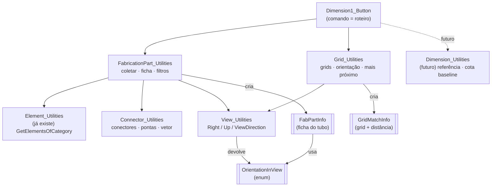
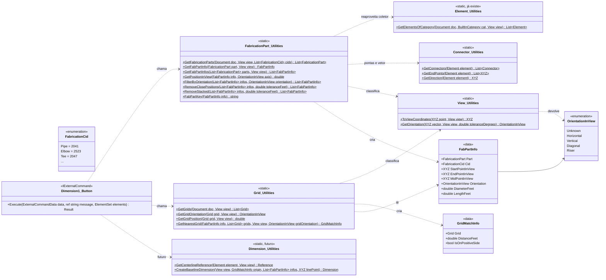
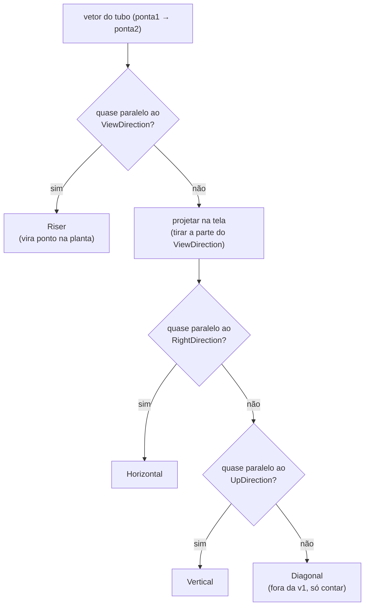
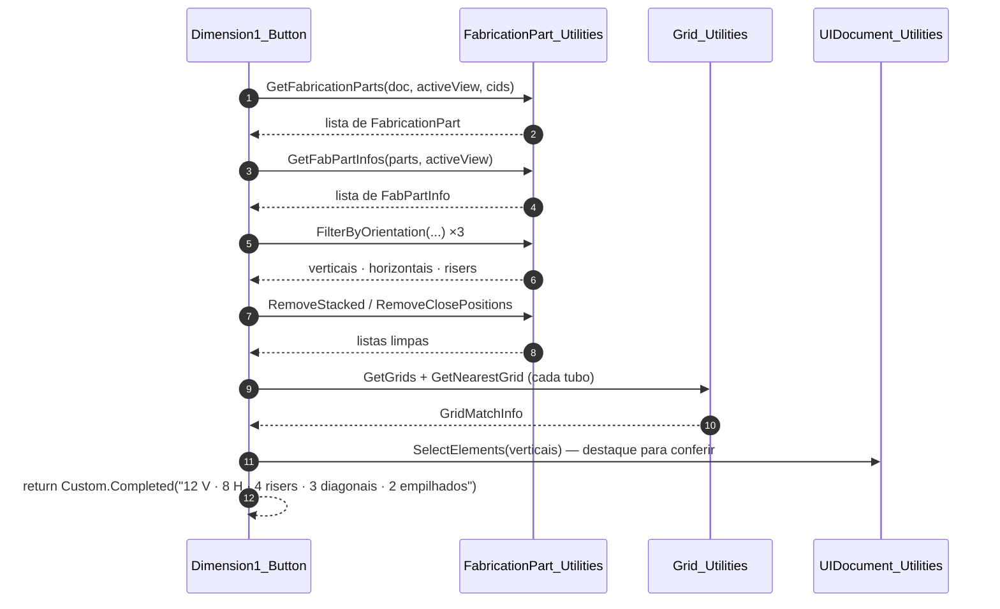

# UML — Cotas escalonadas de Fabrication Pipework

> Rascunho de arquitetura (2026-10-16). Nada disto está implementado ainda.
> Nomes de código em inglês, explicações em português. Segue a skill `revit-plugin-dev`.
>
> **Como ver os diagramas:** VS Code com a extensão *Markdown Preview Mermaid Support*, ou cole o bloco
> em <https://mermaid.live>.

---

## 1. Visão geral: quem chama quem

O comando é o roteiro. Cada `_Utilities` é um assunto. `FabPartInfo` é a "ficha" de cada tubo:
calculada **uma vez**, depois só lida.



**Regra de dependência:** `View_Utilities` e `Connector_Utilities` não conhecem tubo nem grid. Elas só
respondem perguntas de geometria. Por isso servem para duto, conduit e grid sem mudar nada.

---

## 2. Diagrama de classes

Legenda Mermaid: `$` = método `static` · `~T~` = `<T>` · `+` = público · `-` = privado.



---

## 3. O que cada peça faz

### `FabricationPart_Utilities`, o assunto "tubo de fabrication"

| Método | Faz | Observação |
|---|---|---|
| `GetFabricationParts(doc, view = null, cids = null)` | coleta os FabricationParts; `view` = só os visíveis na vista; `cids` = só esses CIDs | Filtrar pela **categoria** `OST_FabricationPipework`, porque hangers e dutos também são `FabricationPart`. Reaproveita o padrão de `Element_Utilities.GetElementsOfCategory`. Lista de CIDs em vez de um só, porque tubo reto pode ter mais de um CID no seu database. |
| `GetFabPartInfo(part, view)` | monta a ficha de **um** tubo | Lê os conectores e a orientação uma vez só. Se não tiver 2 conectores, sai com `Orientation = Unknown`. |
| `GetFabPartInfos(parts, view)` | ficha de todos | só um `foreach` sobre o anterior |
| `FilterByOrientation(infos, orientation)` | separa as listas (verticais, horizontais, risers) | o comando chama 2 ou 3 vezes |
| `RemoveClosePositions(infos, toleranceFeet)` | posições a menos de 1" → fica o de **maior diâmetro** | sua regra |
| `RemoveStacked(infos, toleranceFeet)` | tubo **embaixo** de outro → fica o de cima | precisa de 2 condições: mesma posição E sobreposição ao longo do comprimento (ver §5) |
| `FabPartKey(info)` | texto para debug: `"#123456 CID 2041 Ø4\" Vertical X=12.50"` | no `Debug.WriteLine` e nas mensagens |

### `Connector_Utilities`, o assunto "conector" (vale para qualquer MEP)

| Método | Faz | Observação |
|---|---|---|
| `GetConnectors(element)` | lista de conectores | Cada tipo guarda em um lugar: `FabricationPart.ConnectorManager`, `MEPCurve.ConnectorManager` (Pipe), `FamilyInstance.MEPModel.ConnectorManager` (acessório). Um método esconde essa diferença. |
| `GetEndPoints(element)` | as origens (`Connector.Origin`) | |
| `GetDirection(element)` | vetor ponta1 → ponta2, ou `null` se não tiver exatamente 2 | Só faz sentido em **tubo reto**. Num cotovelo, as 2 pontas formam uma diagonal falsa. |

### `View_Utilities`, o assunto "orientação na tela"

Todo `View` tem três setas, em coordenadas do modelo:

| Propriedade | Aponta para | Na planta |
|---|---|---|
| `view.RightDirection` | a direita da **tela** | "X da tela" |
| `view.UpDirection` | o topo da **tela** | "Y da tela" |
| `view.ViewDirection` | **para fora da tela**, na direção de quem olha | o "Z" (para cima, numa planta) |

Numa vista rotacionada, essas setas giram junto com a vista. Por isso a classificação usa elas, e não
X/Y do projeto.

| Método | Faz |
|---|---|
| `ToViewCoordinates(point, view)` | converte um ponto do modelo para (x da tela, y da tela, profundidade), com 3 produtos escalares |
| `GetOrientation(vector, view, toleranceDegrees)` | classifica um vetor: Riser → Horizontal → Vertical → Diagonal |

### `Grid_Utilities`, o assunto "grid"

| Método | Faz | Observação |
|---|---|---|
| `GetGrids(doc, view)` | grids visíveis na vista | ignorar grid em arco e multissegmento na v1 |
| `GetGridOrientation(grid, view)` | Horizontal / Vertical na tela | reaproveita `View_Utilities.GetOrientation` com o vetor do `grid.Curve` |
| `GetGridPosition(grid, view)` | a coordenada fixa do grid (x para grid vertical, y para horizontal) | |
| `GetNearestGrid(info, grids, view)` | grid mais próximo **do tubo**, entre os paralelos a ele | devolve `GridMatchInfo` (grid + distância + lado) |

### Classes de dados (arquivo próprio cada uma, como `WorksharingResult`)

| Classe | Por que existe |
|---|---|
| `FabPartInfo` | Sem ela, cada etapa (classificar, comparar proximidade, achar grid) releria os conectores e refaria as contas. Com ela, a conta é feita uma vez e o comando trabalha com listas simples. E no breakpoint você vê tudo do tubo num lugar só. |
| `GridMatchInfo` | Um método devolve uma coisa só: o grid **e** a distância **e** o lado vão juntos. |
| `OrientationInView` (enum) | Um conjunto fechado de respostas. `Orientation == OrientationInView.Vertical` lê melhor e erra menos que texto `"vertical"`. |

**O campo mais importante da ficha é `PositionFeet`:** a coordenada que **não muda** ao longo do tubo.

| Orientação | `PositionFeet` = | Cota que recebe |
|---|---|---|
| Vertical | x da tela | horizontal (mede X) |
| Horizontal | y da tela | vertical (mede Y) |
| Riser | x **e** y (um ponto) | as duas: ver §6 |

---

## 4. Classificação de orientação (fluxo do `GetOrientation`)

A ordem importa: o riser é testado **primeiro**.



Tubo com caimento ou offset a 45° descendo no sentido N-S: depois da projeção ele fica alinhado ao
`UpDirection`, então é **Vertical**. Faz sentido, porque o X dele não muda.

---

## 5. Os dois filtros de proximidade

```
RemoveClosePositions (mesmo plano, lado a lado)      RemoveStacked (um embaixo do outro)

   │Ø4   │Ø2                                           vista de cima:     corte:
   │     │      ← X diferem 3/4"                         ║  (os dois           ═══ Ø6  (em cima)
   │     │        < 1" → fica o Ø4                       ║   coincidem)        ═══ Ø4  (embaixo)
                                                                              → fica o Ø6 (o de cima)
```

| Filtro | Condição | Quem fica | Critério de desempate |
|---|---|---|---|
| `RemoveClosePositions` | mesma orientação + `PositionFeet` a menos da tolerância | maior `DiameterFeet` | **a decidir**: diâmetros iguais → o mais comprido? |
| `RemoveStacked` | mesma posição + **sobreposição ao longo do comprimento** + profundidades diferentes | maior `DepthFeet` (mais perto de quem olha = em cima) | — |

Por que a sobreposição ao longo do comprimento: dois tubos verticais com o mesmo X, um no norte da
vista e outro no sul, **não** estão um embaixo do outro. São dois tubos que só têm o mesmo X.

**Pergunta em aberto:** os dois filtros são a mesma regra com desempates diferentes? Se um tubo
está embaixo de outro *e* o de baixo é maior, qual fica?

---

## 6. O roteiro do comando (versão "só lógica", sem cotas ainda)



**Os risers entram nas duas cotas:** na cota horizontal pelo x e na vertical pelo y. Por isso o
comando junta `verticais + risers` quando a linha for horizontal, e `horizontais + risers` quando
for vertical.

---

## 7. Ordem sugerida de implementação

Cada passo compila, roda e dá para conferir no Revit **sem alterar o modelo** (sem `Transaction`).

| # | Passo | Como testar |
|---|---|---|
| 1 | `GetFabricationParts` | mensagem com a contagem: vista x modelo, com e sem filtro de CID |
| 2 | `Connector_Utilities` | selecionar 1 tubo → mensagem com nº de conectores e o vetor |
| 3 | `View_Utilities` + enum | selecionar tubos → "Vertical/Horizontal/Riser/Diagonal"; repetir em vista **rotacionada** |
| 4 | `FabPartInfo` + `FilterByOrientation` | selecionar na tela só os verticais (`UIDocument_Utilities.SelectElements`) |
| 5 | `Grid_Utilities` | mensagem: tubo → grid mais próximo e distância |
| 6 | `RemoveStacked` / `RemoveClosePositions` | contagem antes/depois + selecionar os removidos |
| 7 | (futuro) entrada da linha + `Dimension_Utilities` | aí sim `Transaction` e cotas |
| 8 | (futuro) janela WPF com a linha elástica | só troca a entrada; a lógica 1–7 não muda |

---

## 8. Constantes (todas com unidade no nome)

| Constante | Valor inicial | Onde |
|---|---|---|
| `ORIENTATION_TOLERANCE_DEGREES` | 1.0 (a calibrar) | `View_Utilities` |
| `MIN_DISTANCE_INCHES` | 1.0 | comando, ou parâmetro do `RemoveClosePositions` |
| `MIN_DISTANCE_TO_GRID_INCHES` | 0.125 (regra R3 do padrão) | futuro `Dimension_Utilities` |
| `PIPE_CIDS` | a levantar no database CADmep da CTS | comando |

Revit trabalha em **pés**: converter na hora (`inches / 12.0`) ou com `UnitUtils`.

---

## 9. A confirmar na API (nos stubs, antes de codar)

- `FabricationPart.ItemCustomId`: propriedade do CID.
- `FabricationPart.IsAStraight()`: talvez dispense o filtro de CID para pegar só tubo reto.
- Diâmetro de FabricationPart: parâmetro nativo (`BuiltInParameter`) ou propriedade do conector (`Connector.Radius`).
